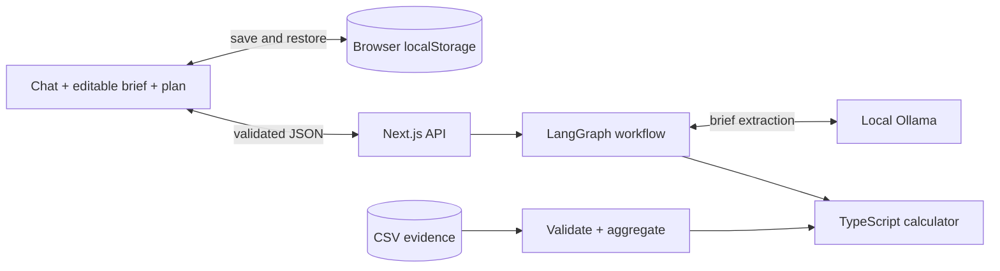
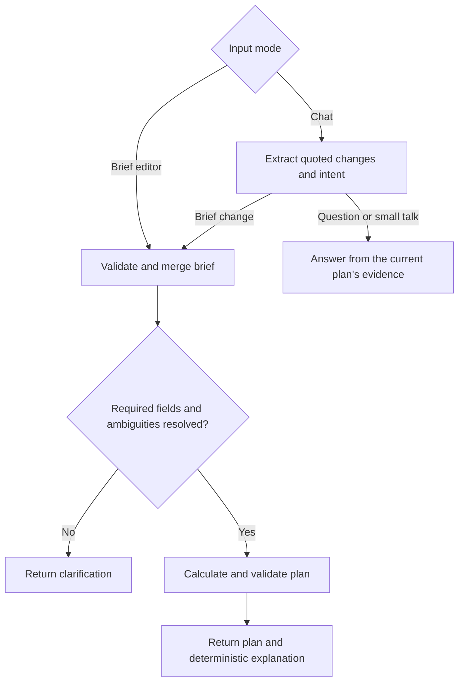

# Kargo Media Planner

A Next.js assessment app that turns a campaign brief into a feasible media plan. The model interprets language; TypeScript owns the calculations, constraints, and rankings. The brief editor works without a model.

## Run

Requires Node.js 22+ and npm. From the repository root:

```bash
npm ci
mkdir -p data/private && unzip -jo "/path/to/AI_Engineer_Case_Study.zip" "AI Engineer Case Study/*.csv" "AI Engineer Case Study/client_briefs.json" -d data/private
npm run dev
```

Open **http://127.0.0.1:3000**. Choose **Enter details manually** to calculate immediately. For production mode, run `npm run build` followed by `npm start`.

The `unzip` step copies the four input files into ignored `data/private/`: `product_catalog.csv`, `campaign_history.csv`, `inventory_forecaster.csv`, and `client_briefs.json`. If the archive is already extracted, set `DATA_DIR` to that folder instead. Both API routes share one cached dataset, so restart after replacing data.

### Local chat model

On macOS, install [Ollama with Homebrew](https://formulae.brew.sh/formula/ollama):

```bash
brew install ollama
brew services start ollama
ollama pull qwen2.5:14b
curl http://127.0.0.1:3000/api/status
npm run test:live
```

The status endpoint should report `modelReady: true`. The service runs locally and starts at login; stop it with `brew services stop ollama`. Other installations can use [Ollama's installer](https://ollama.com/download) and `ollama serve`.

The default [Qwen2.5 14B model](https://ollama.com/library/qwen2.5:14b) downloads about 9 GB. Extraction uses a non-thinking instruction model with schema-constrained output and application validation.

An optional `.env.local` can override `OLLAMA_BASE_URL` (default `http://127.0.0.1:11434`), `OLLAMA_MODEL` (`qwen2.5:14b`), and `DATA_DIR` (`data/private`). The adapter and status endpoint share one server configuration. No paid API or database is required. A hosted server would need its own reachable model endpoint; it cannot use your laptop's `localhost`.

## Architecture





The graph has five nodes: extract, merge, clarify, calculate, and answer. A chat turn needs one model call, which extracts quoted changes and classifies intent as a brief change, a question, or small talk. Code routes on that intent, and any message that sets or flags a field counts as a brief change. Questions get the plan's rationale, recalculated from evidence; small talk gets a short prompt for what is still needed; the calculator validates its own result and explanation text comes directly from verified evidence. Clarification ends the request; the next message supplies the current brief and unresolved fields. The server recalculates every recommendation from its evidence. No campaign state lives in a server global and no graph checkpointer is needed.

| Code                                                              | Responsibility                                                       |
| ----------------------------------------------------------------- | -------------------------------------------------------------------- |
| `src/lib/brief.ts`, `contract.ts`                                 | Campaign fields; HTTP request/response schemas and body size limits  |
| `src/lib/data.ts`                                                 | Parse CSVs, validate joins, aggregate history, fingerprint and cache |
| `src/lib/recommend.ts`                                            | Feasibility, ranking, two-product allocation, feasibility invariants |
| `src/lib/model.ts`, `workflow.ts`                                 | Ollama adapter, quote validation, and LangGraph routing              |
| `src/lib/evidence.ts`                                             | Number formatting and all user-facing explanation text               |
| `src/lib/conversations.ts`, `src/components/use-conversations.ts` | Chat state, persistence, and request cancellation                    |
| `src/components/workspace.tsx`, `plan-panel.tsx`                  | Navigation, conversation, editable brief, and results                |
| `src/app/api/`                                                    | Chat requests with bounded bodies, and local setup status            |

## Decision rules

Required fields: vertical, KPI, geography, and budget. Campaign name and minimum impressions are optional. Supported values: Retail/Finance/Travel/QSR/Entertainment; CTR/in-view rate; US/EMEA/APAC.

- **Benchmarks:** sum clicks or viewable impressions, then divide by total impressions for each product/vertical. Do not average row rates.
- **Budget ceiling:** a single product receives `min(budget / CPM × 1,000, available inventory)`. Report spend and unused budget; do not round before checking constraints.
- **Confidence:** use raw inventory. Disclose `inventory_risk` as forecast confidence; higher breaks equal-KPI single-product ties. It is neither a delivery probability nor an inventory multiplier.
- **Singles first:** consider pairs only when no single meets a supplied impression goal. Maximize `(x × rateA + y × rateB) / (x + y)` within budget, both inventory limits, and the minimum goal. Enumerating feasible vertices solves this small allocation problem. Equal-KPI pairs prefer greater spend; final ties use stable product IDs.
- **Output:** one recommendation, up to two feasible alternatives, and every product's rejection reason.

History has no geography or dates; inventory has no time dimension. Historical performance is not guaranteed. Product impressions add together, but are not deduplicated audience reach.

Two useful demos: Finance/US, $20,000, CTR, 800,000 minimum impressions selects Commerce Connect; Premium Takeover buys only 625,000 impressions. QSR/US, $15,000, in-view rate, the same minimum selects Social Amplifier and leaves $51 unused.

## State and failure behavior

Each chat saves its messages, draft, brief, pending questions, and result in this browser. Saves are debounced by 300 ms and flushed on chat navigation, page hiding, and unmount. New chat preserves earlier conversations. Edits immediately invalidate results; request IDs prevent late responses from overwriting newer edits or another chat. Interrupted requests recover as drafts after refresh. Changed dataset fingerprints invalidate saved results.

Storage is local to this browser and origin, with no account sync or concurrent-tab merging. Clearing browser data removes chats; storage failures show a notice. The transcript is not sent as accumulated model history: each request sends the latest message, canonical brief, and unresolved fields.

The model returns each changed value and issue with its source quote. One extraction schema, derived from the campaign fields, is both the Ollama response format and the workflow's validation; every quote must appear in the message. Quotes and structured output do not prove semantic correctness. Extraction failure preserves the prior brief. Explanations use deterministic text. The editable brief lets the strategist correct interpretation errors. Model calls allow 45 seconds for cold starts, extraction has at most two attempts, and the workflow has an 85-second limit, reported as a model timeout. Input/output sizes are bounded.

## Verify

```bash
npm run check       # TypeScript, unit/integration tests, production build
npm run test:live   # Imported data + real Ollama model; no running app needed
```

Nine dataset-specific tests skip when private inputs are absent, and the live-model tests run only through `test:live`. Model doubles test workflow behavior; `test:live` sends the seven supplied briefs, a vague mobile-game brief, a question, small talk, a what-if change, and an unsupported geography with its correction through the real model and chat route. Tests cover calculations, workflow failures, quoted model output, saved chats, and debounced writes.

## References and delivery

The design follows [LangGraph's workflow model](https://docs.langchain.com/oss/javascript/langgraph/workflows-agents) and [Ollama structured output](https://docs.ollama.com/capabilities/structured-outputs). Dark surfaces adapt the public [Kargo](https://www.kargo.com/) wordmark and colors; they are not an official dark-mode specification. IBM Plex Sans is bundled locally with its [OFL license](src/app/fonts/OFL.txt). Next.js maintains `AGENTS.md` and `CLAUDE.md` as tooling instructions.

For the assessment presentation: demonstrate the two briefs above, explain model versus calculator responsibilities, show a correction and failure recovery, then discuss extraction evaluation, inventory periods, and confidence calibration. The assessment's “30 min. Presentation + Q&A” timing still needs clarification. This README is the sole project guide; a finished slide deck and public submission are separate deliverables.

Assessment data stays private. Publication, deployment, paid services, and submission require approval. No employer code, internal prompts, or credentials are used.
