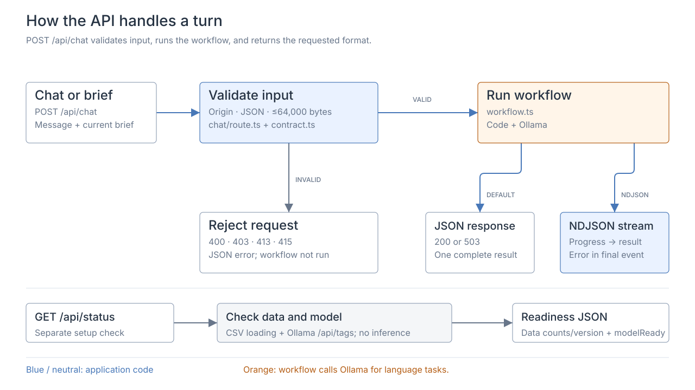

# API

Overview: [request lifecycle](../lifecycle/README.md).

| Endpoint | Purpose | Source |
| --- | --- | --- |
| `POST /api/chat` | Turn a message into a clarification, plan, or error. | [chat/route.ts](../../src/app/api/chat/route.ts) |
| `GET /api/status` | Check data and installed model; return dataset version. | [status/route.ts](../../src/app/api/status/route.ts) |

Requests carry the message, brief, unresolved fields, and recent history. [chat/protocol.ts](../../src/lib/chat/protocol.ts) defines schemas and limits.

The route validates origin, content type, body size, and schema. Responses use JSON, or progress events plus one result with `Accept: application/x-ndjson`. Handled workflow failures return HTTP 503 in JSON mode or an error result in the stream. Cancellation aborts model work.

Reply text arrives complete; the [UI animates it](../ui/README.md#response-presentation).
