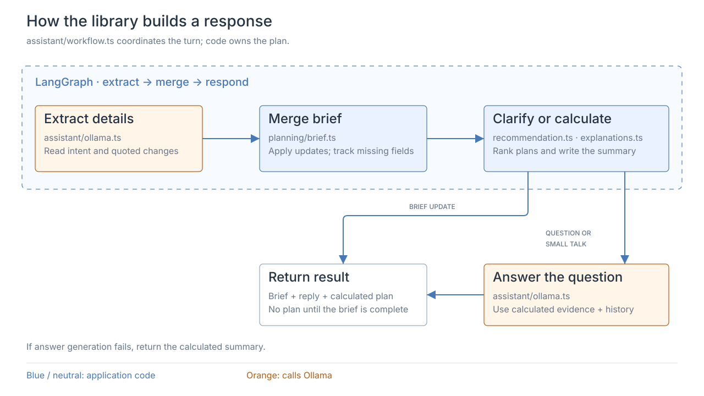
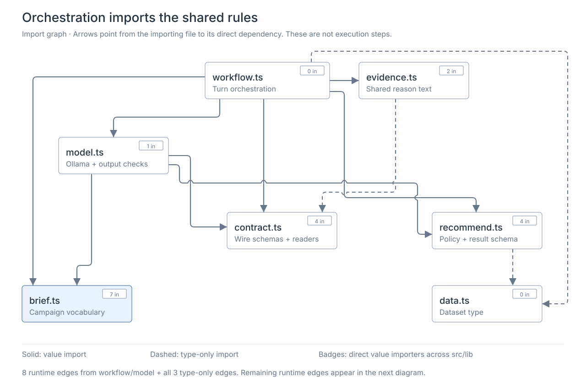
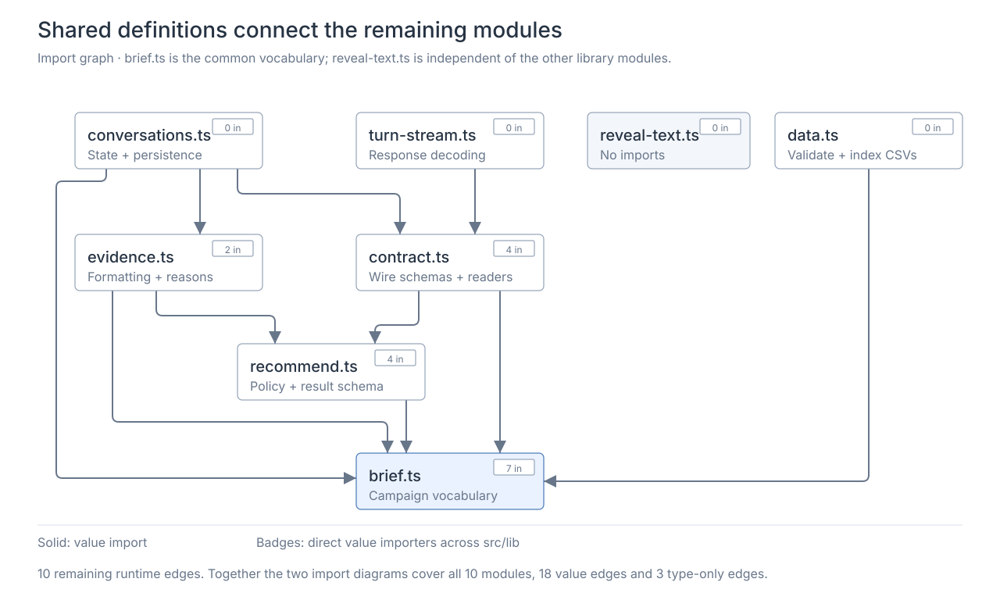

# Media planner library

`src/lib` separates campaign rules, external services, and conversation behavior. TypeScript validates the brief and computes the plan. The LLM extracts user intent and explains calculated evidence; it does not select or allocate products.

## Following a request

1. **Prepare the request.** [use-conversations.ts](../../src/components/use-conversations.ts) sends the latest message, canonical brief, unresolved fields, and up to six earlier messages, each limited to 1,000 characters. Brief-editor requests carry only the explicit brief.
2. **Validate the boundary.** The [chat route](../../src/app/api/chat/route.ts) bounds the body, checks its origin/content type, and parses [contract.ts](../../src/lib/contract.ts). It supplies a cancellation signal and composes `createWorkflow` with `createOllamaModel` and `loadDataset`.
3. **Extract — LLM, then code.** Chat enters the graph's `extract` node. [model.ts](../../src/lib/model.ts) asks Ollama for quoted field changes, issues, and intent. The adapter validates and normalizes the result before returning a typed extraction. Any field change or issue takes precedence over a question classification. Manual briefs skip this node.
4. **Merge — code.** [workflow.ts](../../src/lib/workflow.ts) applies validated changes through [brief.ts](../../src/lib/brief.ts). Omitted fields keep their values; `null` clears them. An unusable correction clears the old value and leaves a pending question.
5. **Respond — code.** An incomplete or pending brief gets a clarification. A complete brief loads indexed evidence through the injected `loadData` function, then [recommend.ts](../../src/lib/recommend.ts) computes and validates the plan. [evidence.ts](../../src/lib/evidence.ts) supplies a deterministic summary.
6. **Explain a follow-up — optional LLM.** After the graph finishes, a pure question or small-talk turn calls `model.answer`. It receives current calculated evidence, shared constraint/ranking reasons, and recent messages for references. Brief changes and manual calculations skip this additional answer call.
7. **Return a verified result.** Answering can replace the first explanation paragraph, never the calculated plan. If generation fails, the verified result survives with its existing summary and a visible fallback notice. Earlier extraction failure instead preserves the previous brief and returns an error.
8. **Present and save.** [turn-stream.ts](../../src/lib/turn-stream.ts) validates progress events and the final response. [reveal-text.ts](../../src/lib/reveal-text.ts) reveals the completed text character by character; animated recommendation results (including infeasible reports) pause one second before resolution. Reduced-motion and background handling can bypass this delay. [conversations.ts](../../src/lib/conversations.ts) applies the result only to the matching request and supports browser persistence.

The LangGraph itself has **three nodes: extract → merge → respond**. Optional answer generation is outside it, so a generation timeout cannot discard an already calculated plan. Each invocation carries its own campaign state; there is no server-side conversation store or graph checkpointer.

The API streams progress plus one completed result as NDJSON. Ollama is called with `stream: false`; the character animation is browser presentation, not model token streaming. Cancellation reaches the HTTP/model operation and the text reveal. Reduced-motion or hidden-chat handling can bypass animation.

## The ten modules

| Module | Main interface | Responsibility and why it is separate |
| --- | --- | --- |
| [brief.ts](../../src/lib/brief.ts) | `briefSchema`, `completeBriefSchema`, `mergeBrief`, `missingFields` | Shared field vocabulary, bounds, and update semantics. Forms, extraction, and calculation agree on one campaign definition. |
| [contract.ts](../../src/lib/contract.ts) | Request/response/event schemas; `readText`, `readChunks` | Shared wire format and bounded stream readers. Browser and server validate the same messages without duplicating protocol rules. |
| [data.ts](../../src/lib/data.ts) | `parseDataset`, `loadDataset`, `loadExampleBriefs` | Validate CSVs, aggregate historical counts, build lookup maps, and fingerprint evidence. File I/O and data cleanup stay outside the calculator. |
| [recommend.ts](../../src/lib/recommend.ts) | `recommend`, `validateRecommendation`, `comparePlans`, `RANKING_POLICY` | Pure feasibility, ranking, and allocation rules. One comparison policy also explains ties; no model, I/O, or session state participates. |
| [evidence.ts](../../src/lib/evidence.ts) | `productReason`, `alternativeReason`, `explainRecommendation`, `answerEvidence` | Shared formatting, clarification text, and evidence explanations. UI and LLM receive reasons derived from the actual ranking rules. |
| [model.ts](../../src/lib/model.ts) | `LanguageModel`, `createOllamaModel`, `validateExtraction` | Ollama transport, extraction validation, and its retry budget. Callers receive validated changes or an error; injectable HTTP keeps failure tests local. |
| [workflow.ts](../../src/lib/workflow.ts) | `createWorkflow({ model, loadData })` | Coordinates extraction, brief state, calculation, and optional answering. Injected services keep orchestration tests independent of model/file availability. |
| [conversations.ts](../../src/lib/conversations.ts) | `workspaceReducer`, `restoreWorkspace`, `createWorkspaceSaver` | Conversation state, form conversion, revision checks, recovery, and debounced saving. The React hook owns browser effects; this module owns state transitions. |
| [turn-stream.ts](../../src/lib/turn-stream.ts) | `readTurnResponse` | Reads NDJSON progress and a final validated result, with JSON fallback. Keeps network framing and incomplete-response handling out of components. |
| [reveal-text.ts](../../src/lib/reveal-text.ts) | `revealText` | Cancellable, grapheme-aware text timing. Presentation can change without changing request processing or stored conversation state. |

## Import graphs

These diagrams show **direct source imports**, with arrows from importer to dependency. They do not show call order, tree-shaken bundle size, or every transitive dependency. Dashed edges are type-only imports and disappear at runtime.

### Orchestration and model dependencies

`workflow.ts` knows the `Dataset` type but receives the loading function from the route. `recommend.ts` also imports only that type. Neither static dependency brings Node file I/O into shared browser code. The third type-only edge lets `evidence.ts` describe a `TurnResponse` without a runtime dependency on `contract.ts`.

### Shared modules and supporting dependencies

There are **18 internal runtime import edges and three type-only edges**, with no cycles in the current source graph. The two diagrams split those edges for readability. External dependencies are listed below instead of repeated around every node.

| Module | Runtime local imports | Type-only local imports | External imports |
| --- | --- | --- | --- |
| `brief.ts` | — | — | `zod` |
| `contract.ts` | `brief`, `recommend` | — | `zod` |
| `data.ts` | `brief` | — | `csv-parse/sync`, `zod`; Node `crypto`, `fs/promises`, `path` |
| `recommend.ts` | `brief` | `data` | `zod` |
| `evidence.ts` | `brief`, `recommend` | `contract` | — |
| `model.ts` | `brief`, `contract`, `recommend` | — | `zod` |
| `workflow.ts` | `brief`, `contract`, `evidence`, `model`, `recommend` | `data` | `@langchain/langgraph` |
| `conversations.ts` | `brief`, `contract`, `evidence` | — | `zod` |
| `turn-stream.ts` | `contract` | — | — |
| `reveal-text.ts` | — | — | — |

A module imported for both values and types appears only in the runtime column. Standard APIs such as `fetch`, `AbortSignal`, and `Intl` are globals, not package imports.

## Runtime boundaries

- **Server-used:** `data`, `model`, and `workflow`. The chat route constructs their dependencies once; each turn receives fresh state. Dataset loading caches a promise per server process, shares concurrent loads, and retries after a failed load. Restart after replacing successfully loaded input files.
- **Shared:** `brief`, `contract`, `recommend`, and `evidence`. They have no Node I/O. Calculation runs on the server; browser code also imports result schemas, labels, policy text, and explanation helpers.
- **Browser-used:** `conversations`, `turn-stream`, and `reveal-text`. Their logic is testable without mounting the UI. Actual `localStorage`, fetch, and React effects live in [use-conversations.ts](../../src/components/use-conversations.ts).

These describe current usage, not an enforced `server-only` or `client-only` marker on every file. Follow-up history helps resolve phrases such as “that alternative”; it cannot replace the canonical brief or current calculated evidence.

The application connects to the library through these callers. Their imports are outside the two library-only graphs above.

| Caller | Direct library imports |
| --- | --- |
| [Chat route](../../src/app/api/chat/route.ts) | `contract`, `data`, `model`, `workflow` |
| [Status route](../../src/app/api/status/route.ts) | `data`, `model` |
| [Server page](../../src/app/page.tsx) | `data` for example briefs |
| [Plan panel](../../src/components/plan-panel.tsx) | `brief`, `evidence`, `recommend`; `conversations` types only |
| [Conversation hook](../../src/components/use-conversations.ts) | `conversations`, `contract`, `turn-stream`, `reveal-text` |
| [Workspace](../../src/components/workspace.tsx) | `contract`, `conversations` |

## Where decisions belong

| Decision | Owner |
| --- | --- |
| Recognize an explicitly requested field change or conversational intent | LLM extraction, followed by schema, quote, and application checks in `model` |
| Required fields, valid values, and clear-versus-preserve behavior | `brief`, enforced during `workflow` merge |
| Historical CTR/viewability and evidence integrity | `data`: ratios of summed counts, validated joins, indexed evidence |
| Eligibility, impressions, spend, selected products, and ordering | `recommend`: deterministic arithmetic, constraints, and ranking |
| Explain a follow-up in natural language | LLM answer using verified result and `evidence` annotations |
| Keep or replace a visible/saved result | `conversations`, coordinated by the UI hook |

Required fields are vertical, KPI, geography, and budget; advertiser name and minimum impressions are optional. Supported values are Retail/Finance/Travel/QSR/Entertainment, CTR/in-view rate, and US/EMEA/APAC.

- **Benchmarks:** divide summed clicks or viewable impressions by total impressions for each product/vertical; do not average row rates.
- **Budget:** a single product receives `min(budget / CPM × 1,000, available inventory)`. Report spend and unused budget without rounding before constraint checks. Minimum impressions are a feasibility threshold, not a target that stops spending.
- **Singles:** rank by historical KPI, then forecast confidence, then stable ID. Use raw inventory; `inventory_risk` means confidence, not a delivery probability or inventory multiplier.
- **Pairs:** consider them only when no single meets a supplied minimum goal. Maximize `(x × rateA + y × rateB) / (x + y)` within budget, inventory, and the goal by evaluating feasible vertices. Ties prefer spend, then stable ID.
- **Output:** one recommendation, up to two feasible alternatives, and every product's rejection reason. Shared policy text lives beside the comparator in [recommend.ts](../../src/lib/recommend.ts).

History has no geography or dates; inventory has no time dimension. Historical performance is not guaranteed. Summed product impressions are not deduplicated audience reach.

The model cannot overwrite result fields through the answer interface, but generated prose can still be wrong. Structured extraction and source quotes also do not prove semantic correctness. The adapter uses JSON mode because schema-constrained generation omitted explicitly requested fields in live checks. The editable brief and evidence display let users inspect and correct interpretation.

## Cost and limits

Let **P** be product count. Vertical and geography lists are currently fixed.

| Work | Time / space | Why |
| --- | --- | --- |
| Dataset loading | Linear in input bytes/rows plus completeness checks; linear working space | History is grouped and aggregated once; request-time lookups use maps. |
| Single-product recommendation | O(P log P) time; O(P) space | Evaluate each product, then sort candidates and evaluated products. |
| Two-product fallback | O(P² log P) time; O(P²) space | Each pair tries at most 15 constraint intersections; pair winners are collected and sorted. |
| Follow-up evidence | O(P) additional work and space | Add existing constraint/ranking reasons to evaluated products; no second allocation calculation. |

Model latency dominates conversational turns. Each HTTP call allows 45 seconds, within one 85-second turn deadline. The adapter allows **at most two extraction calls total**: a transient failure retries the same prompt; malformed output retries with the existing schema included. Both attempts receive the same validation. The graph adds no retry or extraction timer. Permanent HTTP failures, timeouts, and cancellation are not retried. Answers get one call and fall back to the verified summary. Request/history/model-output limits are enforced separately by [contract.ts](../../src/lib/contract.ts), the [route](../../src/app/api/chat/route.ts), and [model.ts](../../src/lib/model.ts).

## Tests and change map

| If changing… | Start here | Check |
| --- | --- | --- |
| Campaign fields or CSV input | `brief`, `data`, then affected contracts/forms | [data.test.ts](../../tests/data.test.ts); [dataset.test.ts](../../tests/dataset.test.ts) for supplied-data regressions |
| Ranking, allocation, or why a product lost | `recommend`, then shared reasons in `evidence` | [recommend.test.ts](../../tests/recommend.test.ts) |
| Extraction, follow-up grounding, or failures | `model`, `workflow` | [workflow.test.ts](../../tests/workflow.test.ts); [live.test.ts](../../tests/live.test.ts) against Ollama |
| HTTP protocol, history bounds, or cancellation | `contract`, route, `turn-stream` | [route.test.ts](../../tests/route.test.ts); [turn-stream.test.ts](../../tests/turn-stream.test.ts) |
| Saved state, stale requests, or display timing | `conversations`, `reveal-text`, UI hook | [conversations.test.ts](../../tests/conversations.test.ts); [reveal-text.test.ts](../../tests/reveal-text.test.ts) |

`npm run check` runs type checking, regular tests, and a production build; `npm run test:live` exercises the real model. Tests use synthetic evidence, the supplied dataset, and injected model/HTTP functions so ordinary checks do not depend on Ollama.

Example tradeoffs: Finance/US, $20,000, CTR, 800,000 minimum impressions rejects the top CTR product because the budget buys only 625,000 impressions; QSR/US, $15,000, in-view rate, the same minimum leaves $51 unused.

References: [LangGraph workflows](https://docs.langchain.com/oss/javascript/langgraph/workflows-agents), [Ollama structured output](https://docs.ollama.com/capabilities/structured-outputs). See [setup](../setup/README.md), [API](../api/README.md), and [UI](../ui/README.md) for integration details.
