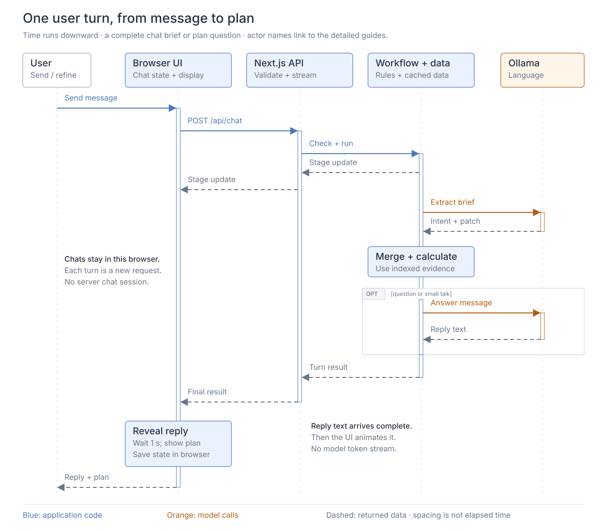

# Request lifecycle

One turn, from message to plan. The browser stores chats and sends the current brief with each request.

Read top to bottom. Open the SVG to follow its documentation links.

## Explore each system

| System | Guide | Diagram |
| --- | --- | --- |
| Browser state and display | [UI](../ui/README.md) | [Response flow](../ui/assets/01-response-flow.svg) |
| Validation and transport | [API](../api/README.md) | [Request flow](../api/assets/01-request-flow.svg) |
| Extraction, calculation, and answers | [Library](../lib/README.md) | [Workflow](../lib/assets/01-request-flow.svg) |

## Other paths

| Event | What changes |
| --- | --- |
| Open or reload | Restore saved chats and check data/model readiness. Interrupted turns become drafts. |
| Missing details | Ask a clarification; the next message carries the brief and unresolved fields. |
| Stop | Abort the request or text reveal. |
| Model failure | Failed extraction preserves the brief. Failed follow-up generation keeps the calculated result and summary. |
