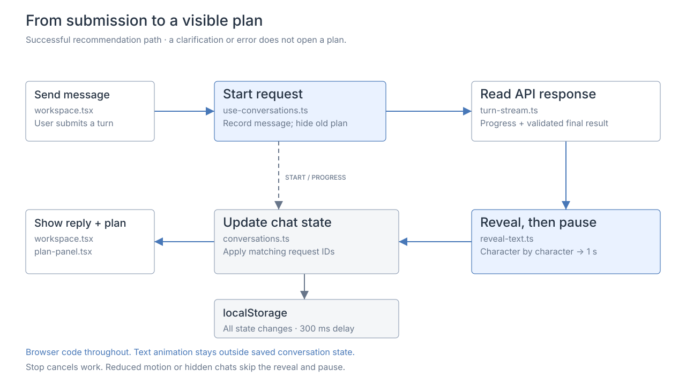

# UI and conversation state

Overview: [request lifecycle](../lifecycle/README.md).

The workspace has chat history, a conversation, and an editable brief/plan panel. **Enter details manually** works without a model.

| File | Responsibility |
| --- | --- |
| [workspace.tsx](../../src/components/workspace.tsx) | Navigation, conversation, and layout. |
| [plan-panel.tsx](../../src/components/plan-panel.tsx) | Brief editing, plan metrics, and alternatives. |
| [use-conversations.ts](../../src/components/use-conversations.ts) | Browser effects, requests, cancellation, and persistence. |
| [conversations.ts](../../src/lib/conversations.ts) | Chat state, revisions, restoration, and saving. |

## Persistence

Chats save messages, drafts, briefs, pending questions, and results in `localStorage`. Saving waits 300 ms after changes, but runs immediately on chat navigation, page hiding, or unmount. Chats stay in this browser and origin; accounts and tabs do not sync. Clearing browser data removes chats; storage failures show a notice.

Editing the brief or changing the dataset clears outdated plans. Request IDs keep late responses from overwriting edits. Interrupted chat requests restore as drafts.

## Response presentation

[turn-stream.ts](../../src/lib/turn-stream.ts) reads [API progress and the final result](../api/README.md). [reveal-text.ts](../../src/lib/reveal-text.ts) displays the completed reply character by character, then waits one second before showing a plan. Cancellation stops the reveal; reduced motion, hidden pages, or leaving the chat skip animation.

The dark theme adapts [Kargo's](https://www.kargo.com/) wordmark and colors. It is not an official Kargo design. IBM Plex Sans uses the [OFL license](../../src/app/fonts/OFL.txt).
